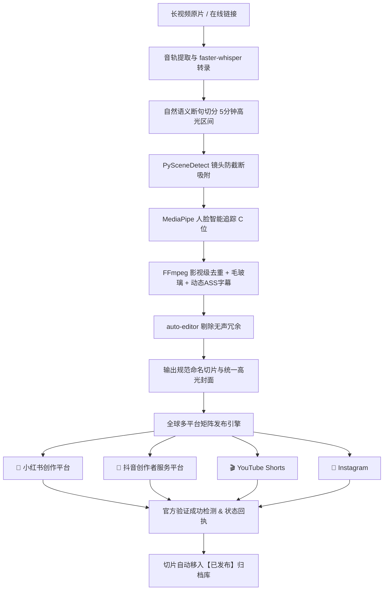

# 🎬 AutoMedia-Factory (自媒体全自动矩阵工厂)

<div align="center">


**全自动 AI 影视解说切片制作 · 跨平台矩阵分发引擎 · 24小时无人值守短视频工厂**  
*支持平台：小红书 📕 · 抖音 🎵 · YouTube Shorts 🎬 · Instagram 📸*

</div>

---

## 🌟 核心特性与亮点 (Key Features)

### 1. 🧠 AI 语义级长视频智能切片
* **语音断句与词级对齐**：基于 `faster-whisper` (CTranslate2 int8) 结合 VAD 智能静音检测，按自然语义对白进行精准切分，彻底告别机械粗暴切断。
* **灵活时长调优**：支持从 1 分钟短视频到 5 分钟深度解说长切片，自动识别剧情高潮区间。
* **智能系列归属与累加自增**：自动提取原视频系列名，根据本地与云端已发布历史记录自增命名（如 `{原片}_切片_01`、`{原片}_切片_02`），杜绝重复与覆盖。

### 2. 🎯 MediaPipe 智能人脸追踪黄金居中
* 自动检测镜头中的人脸坐标与运动轨迹，实现 16:9 横屏向 9:16 竖屏的智能黄金 C 位居中构图，人物永不出框。

### 3. ⚡ 影视级去重与高清压制流水线
* **多维深度去重**：水平画面反转 (hflip) + 播放速率微调 (1.03x) + 电影级色彩质感微调 (eq)，有效避开平台指纹复用检测。
* **动态毛玻璃美化**：画面居中铺满，上下无黑边，配备双层高斯模糊动态背景。
* **动态淡入淡出字幕**：自动生成带 `\fad(100,100)` 呼吸动效的高清 ASS 字幕，并按标点智能折行，防止溢出。
* **智能无声停顿剔除**：集成 `auto-editor`，毫秒级智能剪切视频冗余无声卡顿，提升短视频完播率。

### 4. 🚀 多平台矩阵全自动发布与防闪退机制
* **原生支持主流平台**：深度打通 **小红书创作服务平台**、**抖音创作者服务平台**、**YouTube Studio** 及 **Instagram**。
* **内置浏览器持久化会话**：提供内置浏览器环境，扫码登录一次永久保留登录 Session，发布时全自动加载。
* **智能等待与直到验证完成才关闭**：告别定时粗暴杀进程；系统持续轮询官方管理页面跳转与“发布成功”吐司通知，**直到官方接口确认成功后才安全关闭窗口**。
* **草稿弹窗自愈**：自动识别并清理抖音等平台历史遗留的“放弃编辑”阻塞遮罩。

### 5. 🏷️ 官方创作扶持活动话题自动关联
* 发布时自动整合各平台官方当前正在进行的影视创作激励扶持活动核心话题：
  * **抖音**：`#影视创作者计划 #新剧推介官 #抖音追剧团 #抖音影视解说 #影视名场面 #短视频切片`
  * **小红书**：`#小红书影视创作者计划 #我的观影报告 #影视薯 #追剧日常 #电影解说 #名场面`
* 自动去重并填入标题与简介，助推作品快速进入平台扶持流量池。

### 6. 🖼️ 原片高光统一封面自动提取与绑定
* 自动在长视频正片高能段截取高分辨率清晰画面，生成 `{原片名称}_统一高光封面.jpg`。
* 在小红书、抖音上传切片视频时，自动触发上传并设为作品统一高光封面，保证作品合集封面风格统一。

### 7. 🖥️ Obsidian Cyber 极客桌面可视化总控台 (GUI)
* 深空黑曜石发光界面，无黑框免密启动。
* **Cyber 动态进度条**：实时反馈当前切片处理阶段（0% ~ 100%）。
* **全平台红绿灯状态看板**：实时点亮 小红书、抖音、YouTube、Instagram 的发布成功（绿）、发布中（橙）、未成功（红）状态。
* **待发布路径全景监测**：实时侦测磁盘待发布切片路径、文案及总库余量。

---

## 🏗️ 架构流程图 (Architecture)



---

## 📁 目录结构说明

```plaintext
AutoMedia-Factory/
├── 0_启动自媒体全自动总控台.bat    # 一键启动控制台入口
├── dashboard.py                   # 旗舰桌面 GUI 总控台 (进度条 + 矩阵看板)
├── long_to_shorts_pipeline.py     # AI 长视频切片与出片流水线
├── publish_multi_platform.py      # 多平台全矩阵自动化发布引擎 (含防闪退与持续验证)
├── advanced_video_enhancer.py     # MediaPipe 人脸居中 & auto-editor 增强模组
├── builtin_browser.py             # 自媒体专用内置登录浏览器 (免密持久化环境)
├── download_video_resource.py     # 长视频素材智能检索与 yt-dlp 下载引擎
├── fetch_olevod_hot.py            # 影视爆款选题自动爬取与生成
├── auto_publish.py                # 矩阵自动化发布辅助调度
├── requirements.txt               # Python 依赖清单
├── LICENSE                        # MIT 开源许可证
├── .gitignore                     # Git 忽略配置 (保护私有 Session 与音视频)
└── .env.example                   # 环境参数模板
```

---

## 🚀 快速上手 (Quick Start)

### 1. 环境准备
* **操作系统**：Windows 10 / 11 (推荐) 或 Linux / macOS
* **Python**：Python 3.10 或更高版本
* **FFmpeg**：确保系统环境变量 `PATH` 中包含 `ffmpeg`，或放置于 `C:\Windows\System32\ffmpeg.exe`

### 2. 克隆项目与安装依赖
```bash
git clone https://github.com/your-username/AutoMedia-Factory.git
cd AutoMedia-Factory

# 安装 Python 依赖
pip install -r requirements.txt

# 初始化 Playwright 浏览器内核
playwright install chromium
```

### 3. 配置平台登录状态 (首次使用)
双击运行 `0_启动自媒体全自动总控台.bat`，或在命令行运行：
```bash
python dashboard.py
```
1. 点击控制台界面的 **【🌐 打开自媒体专用内置登录浏览器】**。
2. 依次选择对应平台（小红书、抖音、YouTube、Instagram）完成扫码或密码登录。
3. 登录成功后直接关闭浏览器即可，登录凭证会自动保存在本地加密隔离存储区中，永久免登录。

### 4. 制作切片与自动发布
* **执行长视频切片**：
  ```bash
  python long_to_shorts_pipeline.py --input "你的长视频文件路径或网页链接" --duration 300
  ```
* **一键分发到矩阵平台**：
  ```bash
  python publish_multi_platform.py --count 1
  ```

---

## ⏰ 无人值守定时调度 (可选)

本项目原生支持 Windows 计划任务。你可以设置每天夜间（例如 23:00）自动执行发布任务：
```cmd
schtasks /create /tn "MediaFactory_Matrix_Publish_2300" /tr "python %CD%\publish_multi_platform.py --count 2 --scheduled" /sc daily /st 23:00 /f
```
在无人值守模式下，系统会在后台无感知唤醒执行、发布就绪切片并自动安全归档。

---

## ⚠️ 免责声明 (Disclaimer)

1. 本项目仅供学习、研究和自动化技术交流使用。
2. 使用本项目时请务必严格遵守各大社交媒体平台（小红书、抖音、YouTube、Instagram 等）的《用户协议》和《社区公约》。
3. 切勿将本项目用于任何违法违规、恶意营销、批量垃圾营销或侵害他人合法著作权的场景。使用者对因使用本工具产生的一切法律纠纷与责任自负。

---

## 📄 开源许可证 (License)

本项目遵循 [MIT License](LICENSE) 开源。欢迎 Star、Fork 与提交 Pull Request！
